# 💰 budget-app

파일 기반(JSONL)으로 동작하는 **콘솔 가계부** 프로그램입니다.
단순히 내역을 저장하는 수준을 넘어, 수정/삭제/검색/월별 요약/카테고리 관리/
예산 초과 경고/CSV import·export까지 지원하는 "작은 서비스"를 목표로 만들었습니다.

외부 라이브러리 없이 **Python 표준 라이브러리만** 사용합니다.

---

## 목차

- [주요 기능](#주요-기능)
- [요구 사항](#요구-사항)
- [설치 및 실행](#설치-및-실행)
- [빠른 시작](#빠른-시작)
- [명령어 목록](#명령어-목록)
- [데이터 저장 방식](#데이터-저장-방식)
- [CSV import/export 스키마](#csv-importexport-스키마)
- [프로젝트 구조](#프로젝트-구조)
- [설계 포인트](#설계-포인트)
- [종료 코드 & 에러 처리](#종료-코드--에러-처리)
- [실행 예시](#실행-예시)

---

## 주요 기능

| 기능 | 명령어 | 설명 |
|---|---|---|
| 거래 추가 | `add` | 대화형으로 날짜/타입/카테고리/금액/메모/태그 입력 |
| 거래 목록 | `list` | 최신순 조회, `--limit` 지원, 제너레이터 기반 스트리밍 처리 |
| 거래 검색 | `search` | 기간/카테고리/타입/키워드/태그 조건 검색 |
| 월별 요약 | `summary` | 총수입/총지출/잔액 + 카테고리별 지출 TOP N |
| 예산 관리 | `budget set` | 월 예산 설정 → summary에서 사용률(%) 및 초과 경고 |
| 카테고리 관리 | `category` | 추가/조회/삭제 (사용 중인 카테고리는 대체 지정 필요) |
| 거래 수정 | `update` | id 기반, 옵션으로 원하는 필드만 수정 |
| 거래 삭제 | `delete` | id 기반 삭제, 원자적 파일 교체로 안전하게 처리 |
| 가져오기/내보내기 | `import` / `export` | CSV로 일괄 등록 / 조건별 CSV 내보내기 |

---

## 요구 사항

- Python 3.9 이상
- 추가 설치 패키지 없음 (표준 라이브러리만 사용)

---

## 설치 및 실행

```bash
git clone https://github.com/youngbin0315/codyssey2-1.git
cd codyssey2-1
python -m budget_app --help
```

> `python -m budget_app ...` 명령은 `budget_app/` 폴더가 보이는 **레포 최상위 폴더**에서 실행해야 합니다.
> `budget_app/` 안의 `.py` 파일을 직접 실행(예: `python decorators.py`)하면 상대 import 오류가 납니다.

---

## 빠른 시작

```bash
# 1. 카테고리 확인 (최초 실행 시 food/transport/rent/salary/etc 자동 생성)
python -m budget_app category list

# 2. 거래 추가 (대화형)
python -m budget_app add

# 3. 최근 내역 확인
python -m budget_app list --limit 10

# 4. 이번 달 요약
python -m budget_app summary --month 2026-10 --top 3

# 5. 예산 설정 후 다시 요약 (초과 여부 확인)
python -m budget_app budget set --month 2026-10 --amount 500000
python -m budget_app summary --month 2026-10
```

기본 데이터 저장 폴더는 `./data`이며, `--data-dir` 옵션으로 변경할 수 있습니다.

```bash
python -m budget_app --data-dir ./mydata list
```

`--verbose` 옵션을 주면 실행 로그와 처리 시간이 함께 출력됩니다.

모든 명령은 `-h` / `--help` 로 사용법을 확인할 수 있습니다.

```bash
python -m budget_app search --help
```

---

## 명령어 목록

### 거래

```bash
python -m budget_app add
python -m budget_app list --limit 20
python -m budget_app search --from 2026-10-01 --to 2026-10-31 --category food
python -m budget_app search --q 점심 --tag friend
python -m budget_app update --id T0002 --amount 20000 --memo "수정된 메모"
python -m budget_app delete --id T0003
```

> `update`는 **옵션 기반**으로 고정되어 있습니다(대화형 방식은 미지원).
> 지정한 옵션의 필드만 바뀌고, 나머지는 기존 값이 유지됩니다.

### 요약 / 예산

```bash
python -m budget_app summary --month 2026-10 --top 3
python -m budget_app budget set --month 2026-10 --amount 500000
```

### 카테고리

```bash
python -m budget_app category list
python -m budget_app category add hobby
python -m budget_app category remove food --replacement etc
```

> 사용 중인 카테고리를 삭제하려면 `--replacement`로 대체 카테고리를 지정해야 합니다.
> 지정하지 않으면 삭제가 거부됩니다.

### 가져오기 / 내보내기

```bash
python -m budget_app import --from ./sample_import.csv
python -m budget_app export --out ./out_2026-10.csv --month 2026-10
python -m budget_app export --out ./out_range.csv --from 2026-10-08 --to 2026-10-10
```

> `export`는 `--month` 또는 `--from`/`--to` 중 최소 하나의 조건이 반드시 필요합니다.

---

## 데이터 저장 방식

- 포맷: **JSONL** (한 줄 = JSON 객체 하나)
- 기본 폴더: `./data` (없으면 최초 실행 시 자동 생성)
- 3개 파일로 분리 저장:

| 파일 | 내용 |
|---|---|
| `data/transactions.jsonl` | 거래 내역 |
| `data/categories.jsonl` | 카테고리 목록 (최초 실행 시 기본값 자동 생성) |
| `data/budgets.jsonl` | 월별 예산 |

`transactions.jsonl` 한 줄 예시:

```json
{"id": "T0001", "type": "income", "date": "2026-09-01", "amount": 3000000, "category": "salary", "memo": "9월 월급", "tags": []}
```

수정/삭제 시에는 임시 파일에 전체 내용을 먼저 쓰고 `os.replace()`로
**원자적으로 교체**하여, 중간에 프로세스가 죽어도 원본 파일이 깨지지 않도록 했습니다.

---

## CSV import/export 스키마

인코딩 UTF-8(BOM 없음), 첫 줄은 헤더 필수.

| column | required | 설명 |
|---|---|---|
| `date` | Y | `YYYY-MM-DD` |
| `type` | Y | `income` / `expense` |
| `category` | Y | 등록된 카테고리 (없으면 오류) |
| `amount` | Y | 양수 정수 |
| `memo` | N | 문자열 |
| `tags` | N | 쉼표(`,`)로 구분된 문자열 |

예시 (저장소의 `sample_import.csv`와 같은 내용):

```csv
date,type,category,amount,memo,tags
2026-10-09,expense,transport,3000,택시,
2026-10-10,income,etc,50000,용돈,gift
```

---

## 프로젝트 구조

저장소 전체 구성:

```
codyssey2-1/
├── budget_app/          # 소스 코드 (아래 패키지 구조 참고)
├── data/                # 기본 데이터 저장 폴더 (실행 시 자동 생성)
├── demo_data/           # 시연에 사용한 샘플 데이터
├── pictures/            # 실행 예시 화면 사진
├── sample_import.csv    # import 시연용 입력 파일
├── out_2026-10.csv      # export 시연 결과 (월 단위)
├── out_range.csv        # export 시연 결과 (기간 지정)
├── .gitignore
└── README.md
```

소스 코드 패키지 구조:

```
budget_app/
├── __init__.py
├── __main__.py     # python -m budget_app 진입점
├── models.py       # Transaction / Category / Budget dataclass
├── exceptions.py   # 사용자 정의 예외 (원인 + 해결 힌트)
├── decorators.py   # log_execution / measure_time / handle_errors
├── storage.py      # 파일 I/O 담당 (Repository, 제너레이터 스트리밍, 원자적 교체)
├── services.py     # 검증 규칙 + 비즈니스 로직 (BudgetService)
└── cli.py          # argparse 기반 CLI, 대화형 입력, 출력 포맷팅
```

레이어별 책임:

| 계층 | 파일 | 책임 |
|---|---|---|
| 모델 | `models.py` | 데이터의 "모양"만 정의 |
| 저장소 | `storage.py` | 파일을 어떻게 읽고 쓸지만 담당 |
| 서비스 | `services.py` | 검증/계산/조합 등 실제 비즈니스 규칙 |
| CLI | `cli.py` | 입력 파싱 → 서비스 호출 → 결과 출력 |

---

## 설계 포인트

### 제너레이터 기반 스트리밍

```python
def iter_all(self) -> Iterator[Transaction]:
    with self.path.open("r", encoding="utf-8") as f:
        for line in f:
            yield Transaction.from_dict(json.loads(line))
```

`list()`로 감싸서 강제로 다 읽지 않는 이상 파일 전체를 한 번에 메모리에 올리지 않습니다.
`search`/`list`/`summary`는 이 제너레이터를 한 줄씩 소비하면서 조건에 맞지 않는 데이터는
즉시 버리기 때문에, 파일이 커져도 메모리 사용량이 급격히 늘지 않습니다.

### 데코레이터로 공통 관심사 분리

```python
@log_execution
@measure_time
@handle_errors
def dispatch(args: argparse.Namespace) -> int:
    ...
```

로그 남기기 / 실행 시간 측정 / 예외 처리(스택트레이스 대신 "원인 + 해결 힌트" 출력)를
비즈니스 로직과 완전히 분리했습니다. `dispatch` 본문에는 `try/except`나 로그 코드가
전혀 없습니다.

### 타입 힌트로 계약 명시

```python
def add_transaction(
    self, date: str, type_: str, category: str, amount: int,
    memo: Optional[str] = None, tags: Optional[List[str]] = None,
) -> Transaction:
```

함수가 무엇을 받고 무엇을 돌려주는지 시그니처만 보고 알 수 있고,
에디터/타입 체커가 실수를 미리 잡아줍니다.

### 원자적 파일 교체

`update`/`delete`처럼 파일 전체를 다시 써야 하는 작업은 임시 파일에 먼저 쓰고
`os.replace()`로 한 번에 교체합니다. 쓰는 도중 실패해도 원본 파일은 그대로 유지됩니다.

---

## 종료 코드 & 에러 처리

- 정상 종료: `0`
- 오류 종료(잘못된 입력, 존재하지 않는 id/카테고리 등): `1`
- 에러 발생 시 파이썬 스택트레이스 대신 아래 형식으로 출력됩니다.

```text
[오류] 존재하지 않는 거래 id입니다: T9999
[해결 힌트] id 또는 이름을 다시 확인해 주세요. list 명령으로 목록을 확인할 수 있습니다.
```

---

## 실행 예시

아래 화면은 모두 시연 전용 폴더(`--data-dir ./demo_data`)에서 실행한 결과입니다.
사진은 `pictures/` 폴더에 있고, 파일 이름의 번호가 촬영 순서입니다.

저장소에 포함된 시연용 파일은 다음과 같습니다.

- `demo_data/`: 시연이 모두 끝난 **최종 상태**의 샘플 데이터입니다. 실행하면 파일이 바뀌므로 복사해서 사용하세요. (`Copy-Item -Recurse demo_data my_demo`)
- `sample_import.csv`: import 시연에 사용한 입력 파일입니다.
- `out_2026-10.csv`, `out_range.csv`: export 시연으로 만들어진 결과 파일입니다.

### 과제 목표별 증빙 사진

| 과제 목표 | 증빙 사진 |
|---|---|
| 파일 기반 저장 (JSONL, 영구 저장) | 01, 14, 15 |
| Create (추가) | 02-1, 02-2 |
| Read (조회) | 03-05 |
| 검색 | 03-05 |
| Update (수정) | 07, 07-2 |
| Delete (삭제) | 08 |
| 월별 요약 · 예산 | 10-11 |
| 입출력 (import / export) | 12, 13 |
| 카테고리 관리 | 06 |
| 에러 처리 · 종료 코드 | 07-2, 09, 13 |

### 초기화: 저장 파일 3개 자동 생성 (사진 01)

처음 실행하면 기본 카테고리가 만들어지고, 데이터 파일 3개가 자동으로 생성됩니다.

```powershell
python -m budget_app --data-dir ./demo_data category list
Get-ChildItem .\demo_data
```

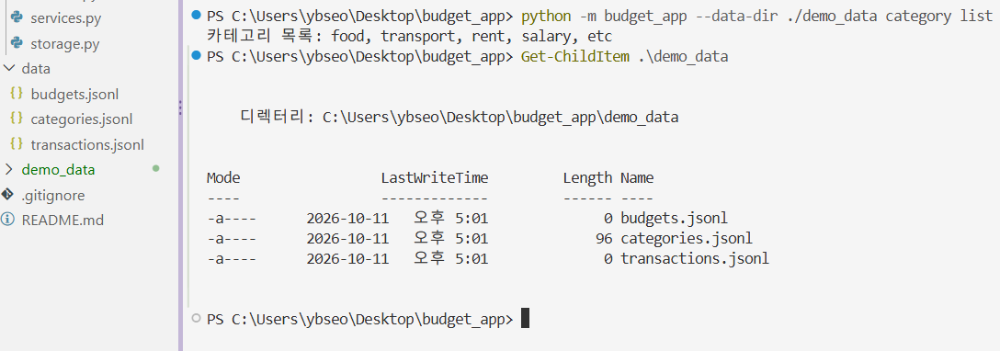

- 기본 카테고리 5개(`food, transport, rent, salary, etc`)가 자동 생성됩니다.
- `budgets.jsonl`, `categories.jsonl`, `transactions.jsonl` 3개 파일이 만들어집니다.

### 거래 추가: Create (사진 02-1, 02-2)

`add`는 날짜, 타입, 카테고리, 금액, 메모, 태그를 순서대로 입력받는 대화형 방식입니다.

```powershell
python -m budget_app --data-dir ./demo_data add
```

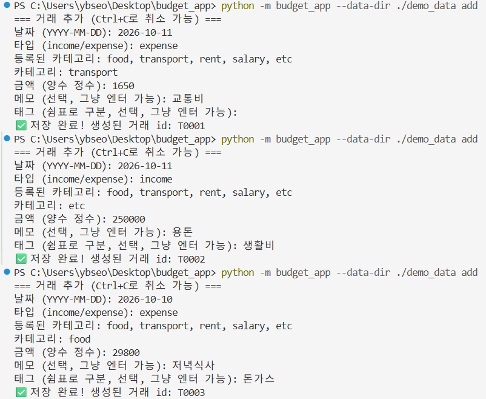

- 저장이 끝나면 생성된 거래 id(`T0001` ~ `T0003`)가 출력됩니다.
- 메모와 태그는 선택 항목이라 엔터로 건너뛸 수 있습니다.

**입력 검증**: 잘못된 값을 넣으면 해당 항목만 다시 물어봅니다.

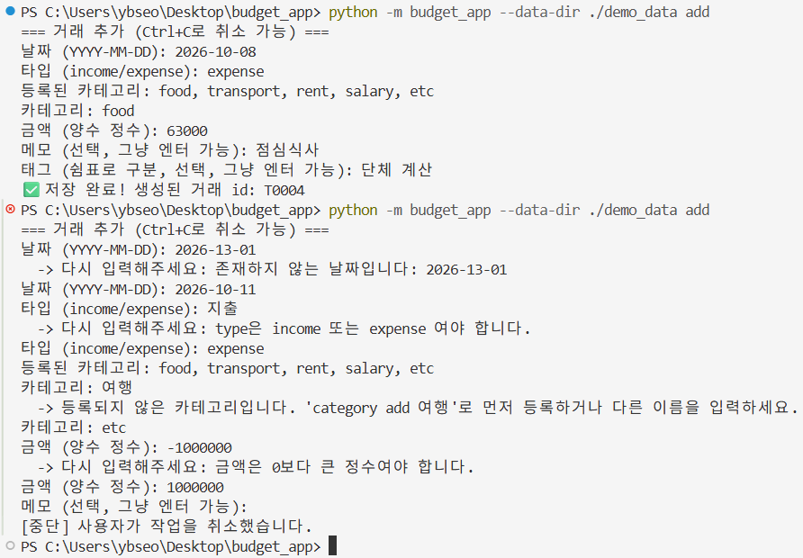

| 잘못된 입력 | 결과 |
|---|---|
| 날짜 `2026-13-01` | 존재하지 않는 날짜 → 재입력 |
| 타입 `지출` | income 또는 expense만 허용 → 재입력 |
| 미등록 카테고리 `여행` | 등록 방법 안내 → 재입력 |
| 금액 `-1000000` | 0보다 큰 정수만 허용 → 재입력 |

마지막 줄의 `[중단]`은 `Ctrl+C`로 입력을 취소한 결과이며, 취소하면 아무것도 저장되지 않습니다.

### 조회와 검색: Read (사진 03-05)

`list`는 최신순으로 출력하고 `--limit`으로 개수를 제한합니다. `search`는 조건을 조합해서 걸러냅니다.

```powershell
python -m budget_app --data-dir ./demo_data list
python -m budget_app --data-dir ./demo_data list --limit 2
python -m budget_app --data-dir ./demo_data search --category food
python -m budget_app --data-dir ./demo_data search --tag 돈가스
python -m budget_app --data-dir ./demo_data search --q 점심식사
python -m budget_app --data-dir ./demo_data search --from 2026-10-10 --to 2026-10-11 --type expense
```

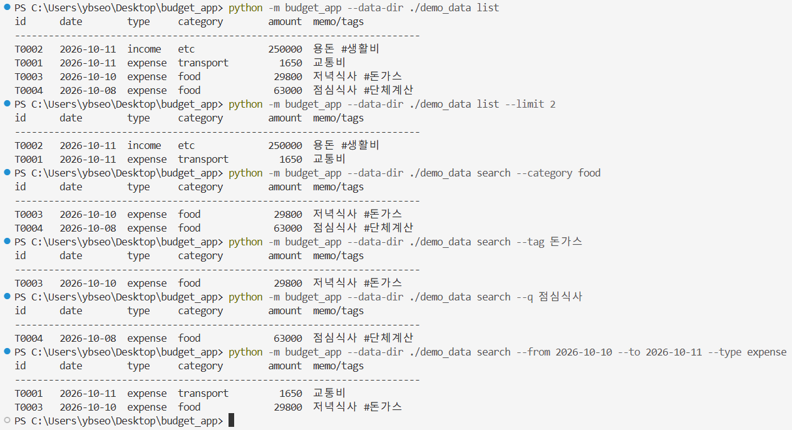

- 모든 결과가 날짜 최신순입니다.
- 카테고리, 태그, 메모 키워드, 기간, 타입 조건으로 검색할 수 있고 여러 조건은 함께(AND) 적용됩니다.
- 태그를 검색할 때는 `#` 없이 입력합니다. (`#`은 화면에 보기 좋게 붙여서 출력하는 기호입니다.)

### 카테고리 관리 (사진 06)

```powershell
python -m budget_app --data-dir ./demo_data category add snack
python -m budget_app --data-dir ./demo_data category list
python -m budget_app --data-dir ./demo_data category remove food
python -m budget_app --data-dir ./demo_data category remove snack
python -m budget_app --data-dir ./demo_data category list
```

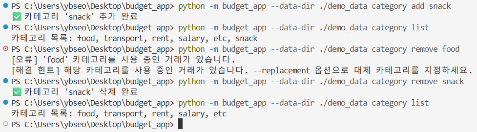

- 사용 중인 `food`는 삭제가 거부되고, 원인과 해결 힌트(`--replacement` 옵션)가 출력됩니다.
- 사용하지 않는 `snack`은 정상적으로 삭제됩니다.

### 거래 수정: Update (사진 07, 07-2)

`update`는 옵션 기반이며, 지정한 필드만 바뀌고 나머지는 그대로 유지됩니다.

```powershell
python -m budget_app --data-dir ./demo_data update --id T0003 --amount 31000 --memo "저녁 식사"
```

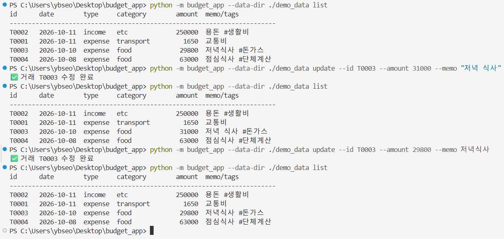

- 금액과 메모만 바뀌고 날짜, 카테고리, 태그(`#돈가스`)는 그대로입니다.
- 메모처럼 공백이 들어간 값은 따옴표로 감싸서 입력합니다.
- 이후 시연 숫자를 맞추기 위해 같은 방식으로 원래 값(29800, 저녁식사)으로 되돌렸습니다.

없는 id를 수정하려고 하면 오류 메시지와 해결 힌트가 출력되고 데이터는 바뀌지 않습니다.

```powershell
python -m budget_app --data-dir ./demo_data update --id T9999 --amount 1000
```

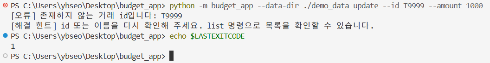

### 거래 삭제: Delete (사진 08)

```powershell
python -m budget_app --data-dir ./demo_data delete --id T0003
```

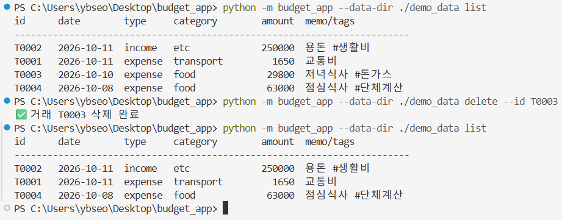

- 삭제한 거래(`T0003`)가 목록에서 사라집니다.
- 파일 전체를 임시 파일에 다시 쓴 뒤 교체하는 방식이라 중간에 중단돼도 원본이 깨지지 않습니다.

### 에러 처리와 종료 코드 (사진 09)

```powershell
python -m budget_app --data-dir ./demo_data delete --id T9999
echo $LASTEXITCODE
```

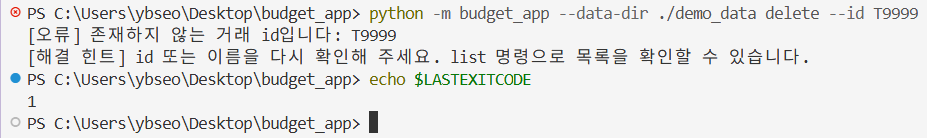

- 스택트레이스 대신 `[오류]`(원인)와 `[해결 힌트]`가 출력됩니다.
- 오류 종료 코드는 `1`, 정상 종료는 `0`입니다.

### 예산과 월별 요약 (사진 10-11)

```powershell
python -m budget_app --data-dir ./demo_data summary --month 2026-10 --top 3
python -m budget_app --data-dir ./demo_data budget set --month 2026-10 --amount 30000
python -m budget_app --data-dir ./demo_data summary --month 2026-10 --top 3
python -m budget_app --data-dir ./demo_data summary --month 2020-01
```

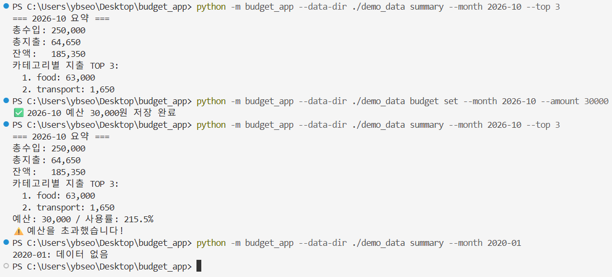

- 예산 설정 전에는 수입, 지출, 잔액, 카테고리별 지출 TOP N만 나옵니다.
- 예산 설정 후에는 사용률(%)이 추가되고, 초과하면 경고 문구가 출력됩니다.
- 거래가 없는 달은 `데이터 없음`으로 표시됩니다.

### CSV 가져오기: import (사진 12)

```powershell
python -m budget_app --data-dir ./demo_data import --from sample_import.csv
python -m budget_app --data-dir ./demo_data list
```

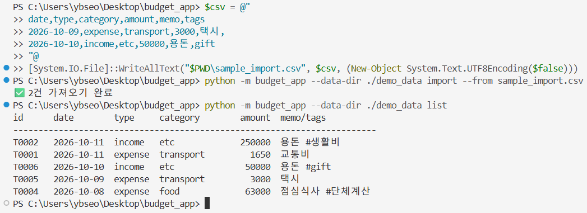

- CSV 2건이 등록되고 처리 건수가 출력됩니다.
- 새 거래의 id는 `T0005`, `T0006`입니다. 삭제된 `T0003`의 번호는 다시 쓰지 않고 가장 큰 번호 + 1로 부여합니다.
- CSV 파일은 UTF-8(BOM 없음)이어야 합니다.

### CSV 내보내기: export (사진 13)

```powershell
python -m budget_app --data-dir ./demo_data export --out out_2026-10.csv --month 2026-10
python -m budget_app --data-dir ./demo_data export --out out_range.csv --from 2026-10-08 --to 2026-10-10
python -m budget_app --data-dir ./demo_data export --out x.csv
echo $LASTEXITCODE
Get-ChildItem *.csv
```

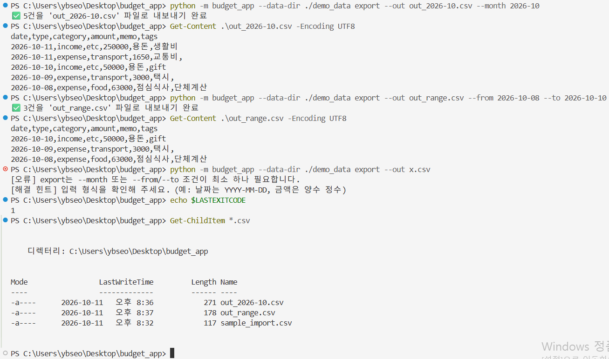

- 월 단위(5건)와 기간 단위(3건) 모두 처리 건수와 CSV 내용을 확인할 수 있습니다.
- `--month` 또는 `--from/--to` 조건이 없으면 에러(종료 코드 `1`)가 나고 파일은 만들어지지 않습니다.

### 영구 저장 확인 (사진 14, 15)

저장 파일의 실제 내용입니다. 한 줄이 JSON 객체 하나인 JSONL 형식입니다.

```powershell
Get-ChildItem .\demo_data
Get-Content .\demo_data\transactions.jsonl -Encoding UTF8
Get-Content .\demo_data\budgets.jsonl
Get-Content .\demo_data\categories.jsonl -Encoding UTF8
```

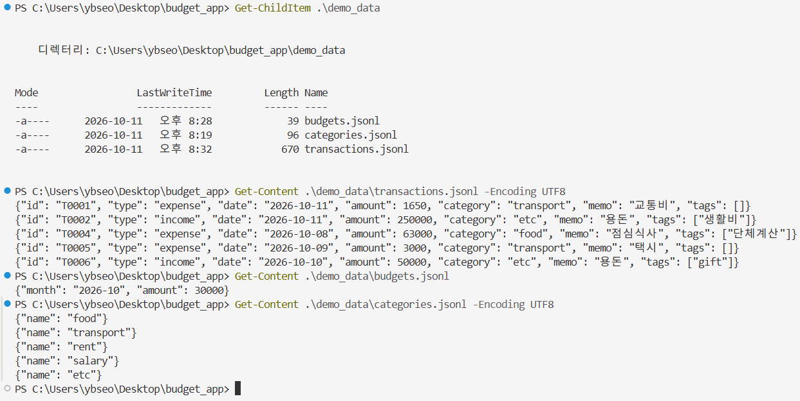

- `tags`는 `["생활비"]`처럼 리스트로 저장되고, 태그가 없으면 `[]`입니다.
- 삭제, import, 수정 결과가 파일에 그대로 반영되어 있습니다.

터미널을 완전히 종료한 뒤 다시 실행해도 데이터가 유지됩니다.

```powershell
python -m budget_app --data-dir ./demo_data list
python -m budget_app --data-dir ./demo_data summary --month 2026-10
```

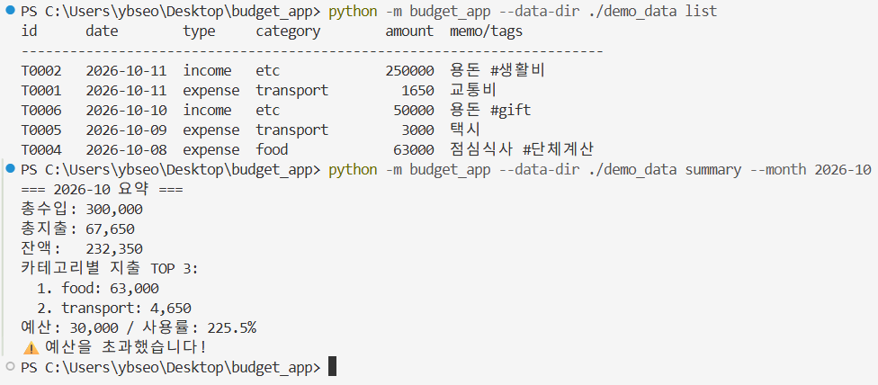

- '예산과 월별 요약' 항목(사진 10-11)과 총지출이 다른 이유는 그 사이 import로 택시 3,000원이 추가되었기 때문입니다. (64,650원 → 67,650원, 사용률 215.5% → 225.5%)
